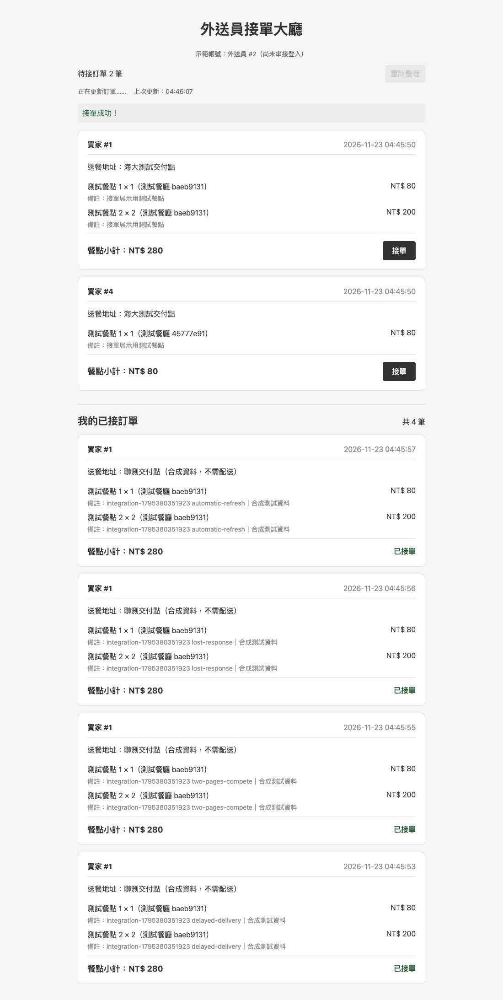

# 接單大廳定時更新

11/18 報告後，組長提到外送員不應該一直自己按重新整理。我這次接著 `main` 的 `126b9cc` 修改接單大廳，把定時更新補上。組員的「我的外送單」原本就有 15 秒更新，我沿用這個間隔。

## 操作上的變化

打開 `/driver.html` 後，待接清單和「我的已接訂單」會一起更新。每輪查詢完成後等 15 秒，再查下一輪，畫面也會顯示上次更新時間。有人下新單就會出現在待接清單；訂單被別人接走，下一輪會移除。

更新時保留原本的卡片，不會一直跳回載入畫面。手動重新整理也保留。正在接單時會先等接單結果，再立刻重查清單；先前還沒回來的查詢會取消，避免把新結果蓋掉。

如果更新失敗，畫面會保留上次的清單並顯示原因，接單按鈕先停用，等重新查詢成功再恢復。切到其他分頁或離線時，會暫停排下一輪更新；回到頁面或恢復連線時，沒有查詢正在進行就會立即更新。如果原本的查詢還沒結束，會先讓它跑完。

## 我怎麼測

測試使用本機 Flask 和 MySQL 8.0.46，每次另外建立一份測試資料。我開兩位外送員的頁面，先確認新訂單能自己出現，再讓其中一人接單，觀察另一邊的清單是否自動移除。也透過組員現有的完成訂單 API，確認「我的已接訂單」會跟著更新。

這三個定時更新案例使用實際 15 秒間隔，沒有按重新整理。原本的舊畫面接單案例另外暫停頁面的計時器，才能固定保留舊卡，測到後端真正回傳的 `409`。

| 檢查 | 結果 |
| --- | --- |
| 既有接單流程加上三個定時更新案例 | 11/11 通過 |
| 定時更新的慢連線、錯誤恢復與競態測試 | 14/14 通過 |
| 前端回應格式、資料一致性和版面 | 13/13 通過 |
| 另外連到 MySQL 核對五張訂單 | 五張都一致 |
| 型別檢查、正式 build | 通過 |

結果見[聯測與資料庫紀錄](evidence/auto-refresh-20261123/integration-results.json)、[雙頁操作紀錄](evidence/auto-refresh-20261123/browser-results.json)和[前端檢查紀錄](evidence/auto-refresh-20261123/browser-audit-results.json)。

另外 14 項是[瀏覽器模擬測試](evidence/auto-refresh-20261123/polling-results.json)：刻意延遲回應、製造錯誤，確認更新不會重疊，連點接單也只送一次。這組用測試時鐘快轉，所有 API 都攔截在瀏覽器內，沒有送到後端。切換分頁的情境由測試控制可見狀態，離線則使用 Chrome 的離線設定。



[另一位外送員的清單](evidence/auto-refresh-20261123/automatic-accepted-1.png)和[更新失敗時保留的畫面](evidence/auto-refresh-20261123/own-orders-load-error.png)也有留下截圖。

## 重跑方式

先照[本機啟動說明](acceptance-runbook.md)準備原本的測試環境。以下命令從專案根目錄執行，Node 和 Playwright 路徑改成自己電腦上已安裝的位置：

```sh
backend/.venv/bin/python -B backend/scripts/local_acceptance.py mysql-start
backend/.venv/bin/python -B backend/scripts/local_integration.py --audit \
  --node /path/to/node \
  --playwright-module /path/to/node_modules/playwright
npm --prefix frontend run build
```

要單獨跑 14 項瀏覽器測試，先開前端，不需要啟動資料庫：

```sh
VITE_DELIVERER_ID=2 npm --prefix frontend run dev -- --host 127.0.0.1 --port 5185 --strictPort
```

另存一份 JSON 設定，`outputDir` 使用新的輸出資料夾，`playwrightModule` 填入已安裝的 Playwright 路徑：

```json
{
  "frontendUrl": "http://127.0.0.1:5185/driver.html",
  "courierId": 2,
  "outputDir": "/absolute/path/to/new-polling-results",
  "playwrightModule": "/absolute/path/to/node_modules/playwright",
  "channel": "chrome"
}
```

在另一個終端執行 `node frontend/tests/acceptance-polling.mjs /absolute/path/to/input.json`，結果會寫進 `outputDir`。這支測試只接受本機網址。

這次先測本機。組員的共用伺服器還在等可連線的網址，之後會再用指定的測試帳號和訂單補測。原本 11/15 的影片與 PDF 保留當時內容，這次更新以這份紀錄和截圖為準。
