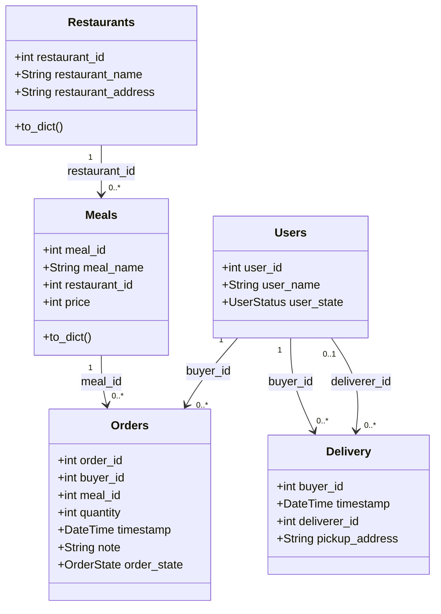
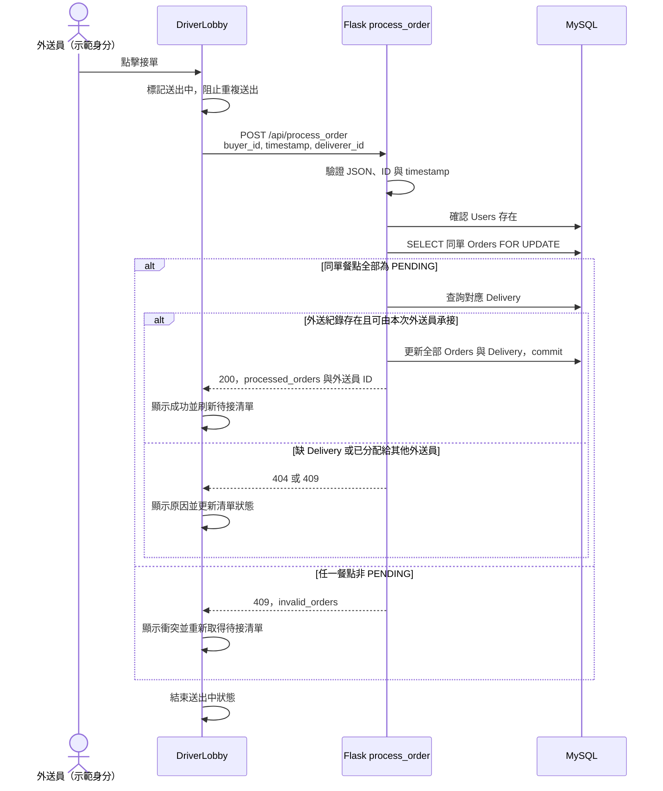
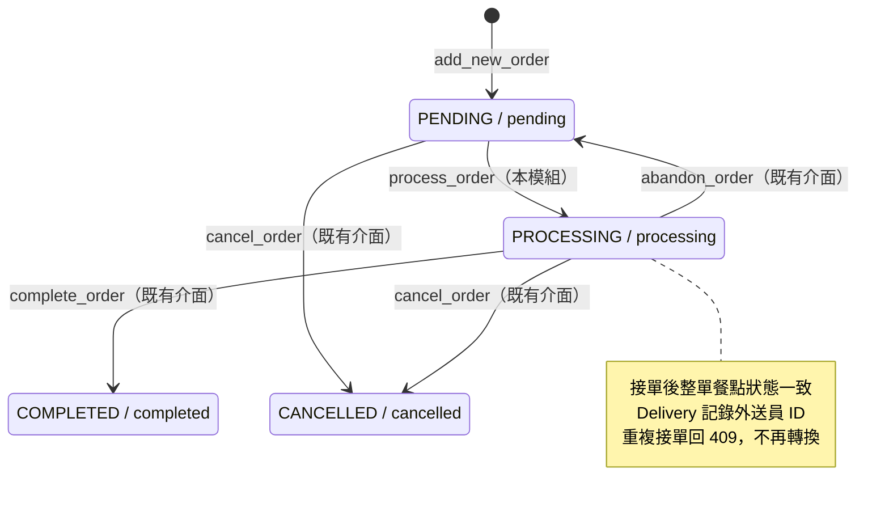

# 接單模組交接素材

負責人：盧益甫。需求對應：`DS-US-06 Take orders`、`FR-DLV-01`。我把接單模組的介面、測試結果和限制整理在這份文件，方便組長整合設計文件，也讓同學能接著測試。

我在 2026-11-14 跑的 MySQL 自動測試 **10/10 通過**，包含 10 輪競爭接單及雙表更新後的 rollback；前端補強 QA **16/16 通過、0 頁面錯誤**，typecheck／build 也通過。字幕 Demo 共 52.44 秒，包含原本 36.44 秒的操作和 2026-11-15 補錄的 16 秒資料庫查詢。測試紀錄和範圍見[驗收對照表](acceptance-checklist.md)，沒有把 PR 作者先前的測試敘述算進來。

PDF 版：[接單設計與驗收素材](接單設計與驗收素材.pdf)。

## 來源與個人範圍

我從同學的 `feature/driver-lobby-vue`／[PR #1](https://github.com/ChangChangHung/NTOU_DeliverySystem/pull/1) 接著做，使用工作分支 `feature/yves20716-order-acceptance`，保留原提交歷史。接單整合、測試和文件都整理在這個分支。

| 來源 | 提交與既有成果 |
| --- | --- |
| PR 的 main 基底 | `2e04307c1b8b54c64e02f5eaedeb54e71cedcdb9`；已有 Flask、SQLAlchemy 資料模型與接單等 API |
| PR #1 head | `bb80ed42ba398f3bf801aebdc127b7fdfdaebf3e`；新增 `DriverLobby.vue`，統一下單時間戳至秒、在接單查詢加入 `with_for_update()`，開發 proxy 改接本機 Flask |
| 我接著完成的部分 | 接單 Demo 入口、前端防重點擊與錯誤／刷新處理、資料檢查；新增隔離 MySQL 測試、合成 seed、可重跑的本機 runner 與交接文件。後端測試與列出的瀏覽器流程都已通過，詳細結果見驗收表 |

我主要確認接單按鈕是否送出正確資料、同單所有餐點是否一起更新，以及資料庫記錄的外送員是否就是接單成功的人。也測了重複接單、成功與衝突提示、載入錯誤。大廳頁面和後端接單邏輯都是同學原本的成果，我接著補強互動和測試。

買家端 `App.vue` 仍使用舊餐廳／下單 API，完整點餐流程還要由團隊整合。我這次負責接單模組，不包含完成訂單、付款、退款、聊天和全組 SDD。示範用外送員 ID 是從測試資料選出的使用者，**登入、身分驗證和角色權限尚未完成**。

## 接單 API（SDD 第 2 章）

前端 `DriverLobby.vue` 點擊接單後，會呼叫 Flask 的 `process_order()`。HTTP 方法為 `POST`，路徑為 `/api/process_order`，Content-Type 為 `application/json`。

| 輸入欄位 | 目前後端規則 |
| --- | --- |
| `buyer_id` | 正整數或可轉成正整數的字串；與時間戳共同辨識整單 |
| `timestamp` | 字串，按 `YYYY-MM-DD HH:MM:SS` 解析；沿用後端提供的值，前端不自行換時區或重建時間 |
| `deliverer_id` | 正整數或可轉成正整數的字串；必須對應既有 `Users` 資料 |

布林值、浮點數、空值及非正整數 ID 會被拒絕，請求必須是 JSON 物件。重跑影片或測試時，要使用隔離 seed 產生的實際 ID，不能直接套用文件範例。

| HTTP 狀態碼 | 原始碼中的條件與回應 |
| --- | --- |
| `200` | 整單成功承接；`success: true`、`message: "訂單承接成功"`，回傳 `buyer_id`、`timestamp`、`deliverer_id` 與 `processed_orders` |
| `400` | JSON 或欄位驗證失敗；回傳 `success: false` 與具體 `message` |
| `404` | `deliverer_id` 不存在、找不到同單餐點，或找不到對應 `Delivery`；回傳 `success: false` 與 `message` |
| `409` | 任一同單餐點不是 `PENDING`，或 `Delivery` 已屬於其他外送員；回傳 `success: false` 與 `message`。非待接狀態的分支另附 `invalid_orders` |
| `500` | 非預期例外；後端 rollback，回傳 `success: false`、`message: "承接訂單失敗"` 及錯誤資訊 |

`processed_orders` 的每筆資料包含 `order_id`、`meal_id`、`quantity`、`order_state`；成功時 API 的狀態字串是小寫 `processing`。`invalid_orders` 包含不符條件的 `order_id` 與小寫狀態值。同一位外送員重送已成功的訂單，目前也是 `409`，不是重回成功。

後端的角色檢查目前被註解掉，接單路由沒有有效的「不是外送員即回 `403`」分支。現在只確認使用者存在，還沒有檢查登入或角色授權。

舊分工文件的 `/api/orders/:id/accept` 與 `Pending → Delivering` 是早期名稱。我這次依目前程式，對接 `/api/process_order` 與 `PENDING → PROCESSING`，組長更新 SDD 時也需要一起改。

## 資料與整單識別（SDD 第 5、6 章）

我依 [backend/server.py](../backend/server.py) 的 SQLAlchemy 模型整理了以下欄位。

| 模型／資料表 | 接單相關欄位 |
| --- | --- |
| `Orders`／`orders` | `order_id`：整數、自動遞增主鍵；`buyer_id`：Users 外鍵；`meal_id`：Meals 外鍵；`quantity`：整數；`timestamp`：非空 DateTime；`note`：可空 String(100)；`order_state`：非空 `Enum(OrderState)`，預設 `PENDING` |
| `Delivery`／`delivery` | `buyer_id` 與 `timestamp`：複合主鍵；`buyer_id`：Users 外鍵；`deliverer_id`：可空的 Users 外鍵；`pickup_address`：非空 String(120) |
| `Users`／`users` | `user_id` 為使用者主鍵。接單先確認傳入的 `deliverer_id` 存在；目前不檢查其 `user_state` |

一筆 `Orders` 是一種餐點的明細；一張完整訂單由相同 `(buyer_id, timestamp)` 的多筆 `Orders` 組成。接單會處理整組資料，而非只更新某一個 `order_id`。`Delivery` 以同一組識別資料記錄外送員與地址；接單前必須已存在。

`OrderState` 在程式中定義 `IN_CART`、`PENDING`、`PROCESSING`、`COMPLETED`、`CANCELLED`，API 透過 `.value` 輸出對應小寫字串。實際模型使用 Enum，不採 HackMD ER 圖中的整數欄位描述；備註欄位實際名稱是 `note`。

以下類別圖可放進 SDD 第 6 章，整理的是實際 SQLAlchemy 模型與重要欄位。實線關係對應目前外鍵；`Delivery` 的 `deliverer_id` 可為 `null`，表示這筆外送紀錄還沒指定外送員。

`Delivery` 的複合主鍵是 `(buyer_id, timestamp)`；API 用這兩個欄位查詢同單 `Orders`，但模型**沒有 Orders 指向 Delivery 的複合外鍵**，所以圖中不畫這條資料庫關聯。`process_order()` 是 Flask 路由函式，不是獨立 service 類別。這張圖只包含接單相關模型，整組類別設計還要另外整合。

## 接單流程（SDD 第 3 章）

後端驗證輸入與使用者後，以 `SELECT … FOR UPDATE` 查詢同一 `(buyer_id, timestamp)` 的全部 `Orders`。只要其中一筆不是待接狀態，就回 `409`；通過檢查後，再確認 `Delivery` 存在且未分配給另一位外送員。最後將全部餐點改為 `PROCESSING`，設定 `Delivery.deliverer_id`，一次 commit。

以下順序圖是目前的接單流程，哪些步驟已測過則列在驗收對照表。

我用自動測試跑了 10 輪，讓兩個 Flask 請求在不同 MySQL 連線上交疊。每輪都是一個 `200`、一個 `409`；再開新連線讀取，同單全部餐點都是 `PROCESSING`，`Delivery` 記錄的外送員也與接單成功的人一致。測試沒有讀 MySQL 的鎖等待表，因此沒有直接觀察到兩條連線同時等待鎖。前端另外用自動測試在同頁同步點擊八次，確認只送出一筆真實接單請求，這兩種測試分開記錄。

這張圖從下單後開始；`IN_CART` 不是可接單狀態。完成、棄單與取消是原本就有的程式路徑，我把它們放進圖裡說明前後關係，沒有列為這次新增的成果。現有取消介面還沒有付款／退款流程，取消權限和賠償規則也還沒由團隊決定。

## 前端與示範素材（SDD 第 1、4、7 章）

大廳使用 `GET /api/view_all_meals`、`GET /api/view_all_restaurants`、`GET /api/view_order_by_stamp` 取得資料，再用 `POST /api/view_meals_of_order` 與 `POST /api/view_delivery` 查詢整單明細與地址；這兩個 POST 是既有查詢介面。接單則呼叫前述 `/api/process_order`。

我新增了 `/driver.html` 與 `driver-main.ts`，也把接單頁加入 Vite build，方便單獨展示。外送員 ID 由 `VITE_DELIVERER_ID` 設定，未設定時沿用 `1`；畫面標示「示範帳號」與「尚未串接登入」。設定值不是正整數時，接單按鈕會停用。示範時使用新 seed 輸出的 ID，步驟見[執行說明](acceptance-runbook.md)。

我補上的前端處理如下，測試條件和還沒測到的部分列在驗收對照表：

- 只列出每筆餐點皆為 `pending`、且唯一對應 `Delivery.deliverer_id` 為 `null` 的訂單。空餐點、空外送紀錄及回傳 JSON 的 `404` 安全略過；缺餐點／餐廳資料或其他查詢錯誤會顯示錯誤，不當成正常空清單。
- 接單送出中停用接單及刷新按鈕，並由函式防止重複送出。
- 已知 JSON `4xx` 回應（包含 `409`）顯示後端原因並刷新。網路中斷、逾時、`5xx` 或成功回應缺少必要識別資料時，顯示「尚無法確認接單結果」，嘗試刷新，不自動重送接單 POST。
- 每個請求設 15 秒逾時；新一輪載入會取消舊載入，並以序號防止舊資料覆蓋新清單。接單結果提示與清單載入錯誤分開呈現。

我跑的[瀏覽器測試](evidence/browser/demo-evidence.json)有七個步驟：初始兩張訂單、多餐點接單成功、刷新後仍隱藏、另一外送員先接走另一單、舊清單收到 `409`、離線載入錯誤、恢復連線後顯示空清單。另一外送員是透過真實本機 API 先接單，沒有開第二個瀏覽器同時搶單；並發接單另外由 MySQL 測試驗證。

測完後，我再[獨立讀取資料庫](evidence/browser/demo-database-state.json)，確認買家 `1` 的兩筆餐點都是 `PROCESSING`、外送員是 `2`；買家 `4` 的另一張單則由外送員 `3` 接走。畫面可參考[初始大廳](evidence/browser/01-lobby.png)、[成功](evidence/browser/02-success.png)、[衝突](evidence/browser/03-conflict.png)、[離線](evidence/browser/04-offline.png)、[恢復空清單](evidence/browser/05-recovered-empty.png)。

2026-11-15 我另外補錄了查詢畫面，在瀏覽器按下查詢，讀取原 Demo schema `ntou_acceptance_demo_20261114_b8877ae024`。買家 `1` 的餐點明細 `1`、`2` 都由外送員 `2` 接下，買家 `4` 的餐點明細 `3` 由外送員 `3` 接下，三筆都是 `PROCESSING`。[SQL](evidence/demo-database-query.sql)、[查詢結果](evidence/browser/demo-database-query.json)和[截圖](evidence/browser/demo-database-query.png)另附。補錄只讀 MySQL，沒有重新接單；影片已標明補錄日期，並非原操作後連續拍攝。

大廳金額目前只是餐點單價乘數量後加總，沒有包含外送費或外送員報酬，也不能用來判斷是否已收款。`pickup_address` 的欄位名稱與畫面的「送餐地址」用詞不同，這部分還要和團隊確認。

目前用 Vue／TypeScript 做前端、Flask 做後端，透過 SQLAlchemy／PyMySQL 連接 MySQL，開發時使用 Vite proxy。我這次的環境是 Node `22.22.2`、Python `3.13.2`、MySQL Community `8.0.46`／InnoDB、Flask `3.1.3`、Flask-SQLAlchemy `3.1.1`、SQLAlchemy `2.1.8`、PyMySQL `1.2.4`、python-dotenv `1.2.4`。完整 Python 套件版本列於 [requirements-lock.txt](../backend/requirements-lock.txt)，[相容性檢查](evidence/python-dependencies.log)確認 19 個套件相容。

## 設計議題與待團隊確認事項（SDD 第 8 章）

| 議題與背景 | 目前程式／待確認內容 | 還需要處理的部分 |
| --- | --- | --- |
| 重複接單 | 沿用 PR #1 的行鎖與狀態檢查；本次 10 輪交疊請求皆一個成功、一個衝突 | 證據只涵蓋測試條件下的兩人接單，不涵蓋取消／棄單與接單之間的競爭 |
| 身分與權限 | `deliverer_id` 由前端傳入；角色檢查未啟用，路由未從登入 session 取得使用者。正式驗證方式、是否可接自己的單須由團隊決定 | Demo 身分不等於登入功能，授權規則要一起討論 |
| 同一買家在同一秒下兩單 | 目前以秒級 `(buyer_id, timestamp)` 分組，同秒兩次下單可能共用整單識別 | 改用獨立訂單主鍵、提高精度或其他方案均需團隊討論，不自行修改 schema |
| 取消／退款及例外 | 現有 API 有取消與棄單，但付款、退款、已購餐後取消、無人接單、顧客未收餐的規則未定 | 依老師回饋補上需求討論；現有狀態更新還不足以涵蓋完整規則 |
| 地址及金額含義 | `pickup_address` 與前端顯示用詞不一致；大廳金額只有餐點小計 | 目前只展示地址和餐點小計，沒有展示取送兩地、外送費計算或付款功能 |

組長可以用這張表整理 Issue、Context、Alternatives、Decision and Rationale、Consequences。還沒決定的項目先保留，等團隊討論後再補方案和理由。

## 測試紀錄與檔案

| 項目 | 紀錄 |
| --- | --- |
| 測試當時的原始碼 | 2026-11-14 以 PR #1 head `bb80ed42ba398f3bf801aebdc127b7fdfdaebf3e` 加上當時尚未提交的更動測試；報告另記錄實際檔案 SHA-256。這是當時的來源，報告中的 HEAD 不代表目前分支版本 |
| MySQL 環境 | `127.0.0.1:3307`、MySQL `8.0.46`／InnoDB；schema `ntou_acceptance_test_20261114_20bce73066`，合成資料保留，可回頭確認測試結果 |
| 後端測試 | 10/10 通過；10 輪競爭、整單持久化、錯誤拒絕、時間戳與雙表更新後 rollback，詳見驗收對照表 |
| 重跑方式 | [acceptance-runbook.md](acceptance-runbook.md)：我的 Mac 使用現有 runtime，同學則可自備 MySQL |
| 最終 typecheck／build | [build 日誌](evidence/frontend-build.log)通過，Vite `8.3.4`，含 `dist/driver.html` |
| 瀏覽器與 DB | 上述七步流程通過；兩張訂單的資料庫狀態與畫面結果一致 |
| 前端補強 QA | [16/16 報告](evidence/browser/qa-results.json)，0 頁面錯誤；真實接單、單頁防連點與注入錯誤分開標示 |
| 本機設定檢查 | [5/5 安全設定測試](evidence/mysql-safety.log)通過，涵蓋 local host、schema 名稱、必要設定與建庫 opt-in |
| 回歸偵測 | [反向實驗](evidence/negative-control.json)只在副本移除 `FOR UPDATE`；單次執行的 10 輪全出現雙 `200`，測試產生 10 個失敗斷言，原始檔雜湊不變 |
| Demo 影片 | [接單功能Demo-含資料庫查詢.mp4](evidence/demo-captioned.mp4)，52.44 秒、1280×900、H.264；前 36.44 秒為原操作，後 16 秒為 2026-11-15 補錄的唯讀 MySQL 查詢。已逐段檢查字幕與畫面，時間軸與講稿見 [Demo 素材](acceptance-demo.md) |
| 合成示範資料 | 每次 `seed` 建立新 schema 並輸出實際 ID；示範身分不代表登入功能 |

完整驗收條件見 [acceptance-checklist.md](acceptance-checklist.md)。我整理的是接單模組的測試紀錄和限制，讓組長整合 SDD、Trello 與展示內容。全組是否達到 40% 實作，還要合併其他模組一起確認。

## 參考來源

- [個人分工](https://hackmd.io/Sl7qt7ewRpGaD5GuaYrxdA)：負責人 5、工作 5-1／5-2。
- [SRD](https://hackmd.io/jziZSyfFSMqihvgTeEMICQ)：`DS-US-06`、`FR-DLV-01`。
- [API 說明](https://hackmd.io/FsQpIO76RKuHLvQURuRMJQ)與[資料庫架構](https://hackmd.io/sku3OVPZQWGYkWZDUXYkIA)：團隊原有文件；這裡的欄位和狀態碼已依原始碼與測試結果核對。
- [SDD 範本](https://hackmd.io/@ldhxSaJmSG-Jmp2kxBS7mA/S1RJ_PP1-e)：各節已標出可放入的章節，全組設計文件仍由組長整合。
- 原始碼：[backend/server.py](../backend/server.py)、[backend/utils.py](../backend/utils.py)、[DriverLobby.vue](../frontend/src/components/DriverLobby.vue)。
